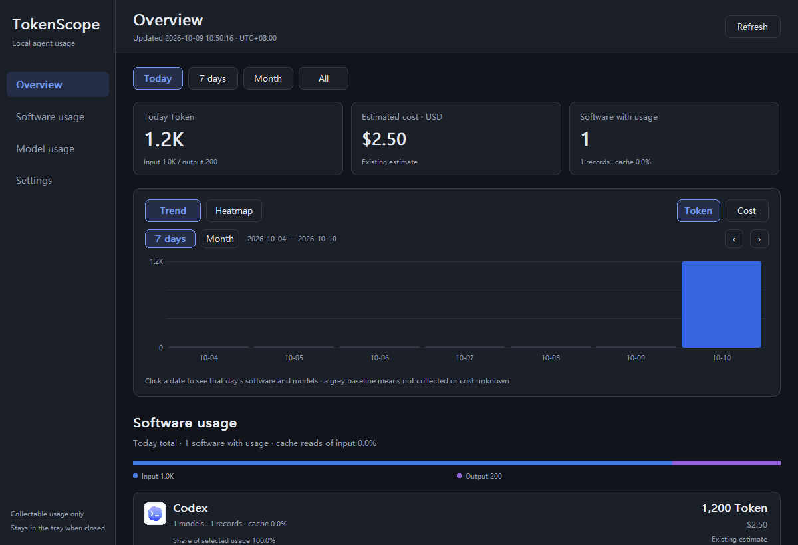
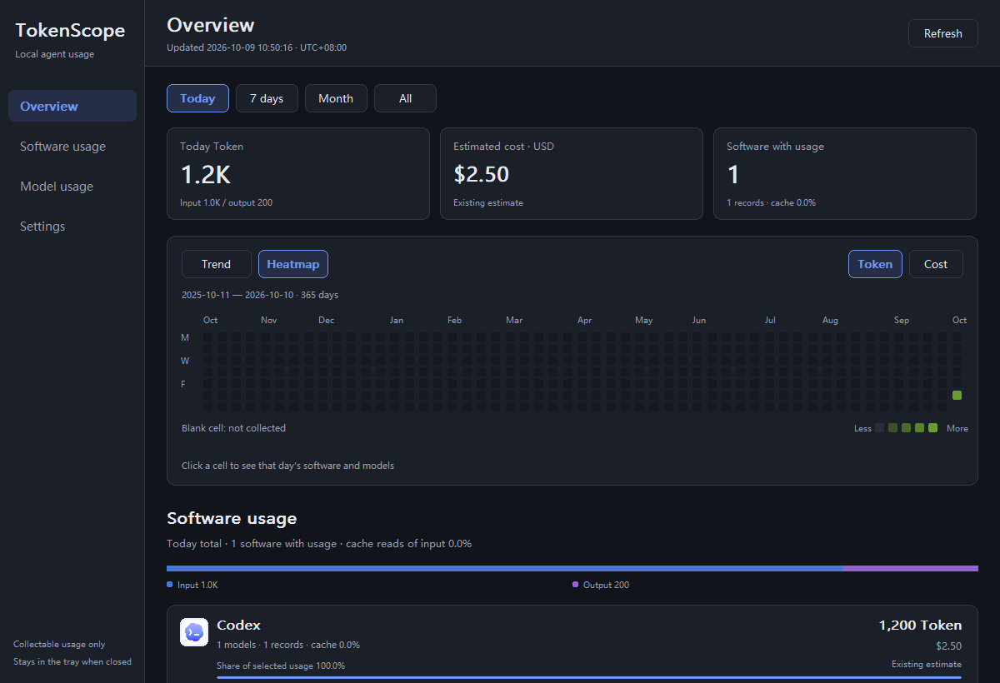

# TokenScope

English · [中文](README.md)

A lightweight, native Windows tray app that totals token usage and estimated API cost across your local AI coding agents (Codex, Claude Code, Cursor, GitHub Copilot, Gemini CLI, Qwen Code, Kimi, OpenCode, Cline, Roo Code and about 50 more). One portable EXE for Windows 10 / 11 x64, under 10 MB, with no installer and no runtime dependencies beyond Windows system DLLs.

<p align="center">
  
  
</p>

Current release: **v0.5.0**, 2,392,064 bytes, SHA-256 `c3e1b074c6cf2a040b1a2c16b3695c10e2728d0d969b771e3771ca3c2a5f9c56`. See the [changelog](CHANGELOG.md).

## Quick start

1. Download `TokenScope.exe` from [Releases](https://github.com/wenzq666/tokenscope/releases/latest) and run it. Nothing is installed.
2. On first start it discovers the local usage logs of supported agents. Only software with real recorded usage appears in the lists.
3. Open **Settings** to pick the currency (USD / CNY), appearance (follow Windows / light / dark), interface language (follow Windows / 中文 / English), budget alerts, or a custom path per source. Closing the window keeps TokenScope running in the tray.

## Features

- **Real usage, real models.** Tokens and estimated cost by software, actual model ID, provider and local day. Unknown models stay unknown. Disjoint buckets for input, output, cache read, cache write, reasoning and unclassified tokens.
- **56 sources.** 28 parsed directly from native formats, 3 through sync caches, and 25 that need a real usage export (`tokenscope.usage.v1` JSON / JSONL, plus verified API, Cursor CSV, Copilot OTel/SDK, Dify and Coze formats). See [coverage](design/support-coverage.md) and the [export format](docs/public-usage-export.md).
- **Reference pricing.** 2,011 bundled price records from LiteLLM, OpenRouter and models.dev, updatable on demand. Cache and reasoning are counted once; long-context tiers use the actual request size; manual rates take priority for unpriced records; priced history is never repriced. Estimates are standard API prices, **not** subscription bills.
- **Charts.** Trend chart and a GitHub-style heatmap of the last year. Clicking a day filters the software and model lists without moving the chart.
- **Live updates.** Watches the discovered source folders and reads new usage within seconds, with a 5-minute fallback check.
- **Budget alerts.** Daily and monthly limits in USD or CNY. A tray notification fires once at 80% and once at 100%.
- **Dark mode and English UI**, both following Windows by default.
- **Local first.** SQLite stores usage metadata only, never conversation text or tool arguments. The optional, experimental Cursor / TRAE International account sync stores its credential encrypted with Windows DPAPI. Nothing about your logs or software is uploaded. The only network calls are public price catalogs and a daily public USD/CNY reference rate (Frankfurter / ECB), plus the account sync if you enable it.

User data lives in `%LOCALAPPDATA%\TokenScope\` (`usage.sqlite3`, `settings.ini`, price caches). The detailed reference for data files, account connections, pricing rules and diagnostics is in the [Chinese README](README.md) and [`docs/`](docs/).

## Building

The toolchain (LLVM-MinGW) is downloaded into `.tools/` and is not installed globally.

```powershell
powershell -ExecutionPolicy Bypass -File scripts/setup-toolchain.ps1
powershell -ExecutionPolicy Bypass -File scripts/build.ps1 -Tests -ViewTests -ExecutableName TokenScope.exe
powershell -ExecutionPolicy Bypass -File scripts/test.ps1
```

`test.ps1` runs 15 test executables and `scripts/check-translations.ps1`, which fails when an interface string has no English text in `src/i18n_en.inc`. Chinese literals in the source are the translation keys: wrap new UI text in `Tr(L"…")` (wide), `Tr8("…")` (UTF-8) or `TrF(L"… {0} …", value)` and add the English line. Formatting follows `.clang-format`.

Optional Authenticode signing (requires `signtool.exe` from the Windows SDK): pass `-SignCertificateThumbprint <thumbprint>`, or `-SignPfx <file>` with the password in `TOKENSCOPE_SIGN_PASSWORD`.

## License

MIT for this project's code and documentation. Third-party components, reference material and brand icons keep their own licenses. See [`vendor/THIRD-PARTY-NOTICES.txt`](vendor/THIRD-PARTY-NOTICES.txt). Brand icons do not imply affiliation.
