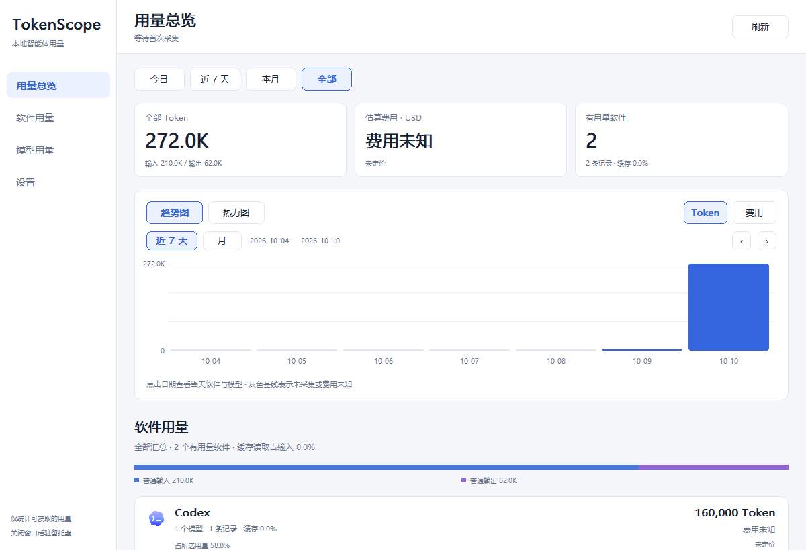

# TokenScope

[English](README.en.md) · 中文

<p align="center">
  
  
</p>

## 快速上手

1. 从 [Releases](https://github.com/wenzq666/tokenscope/releases/latest) 下载 `TokenScope.exe`，双击运行，无需安装。
2. 首次启动自动发现本机 Codex、Claude Code、Cursor 等智能体的本地用量记录；有真实用量的软件才出现在列表里。
3. 在“设置”中切换币种、外观（跟随系统 / 浅色 / 深色）、界面语言（跟随系统 / 中文 / English）、预算提醒，或为某个来源指定路径。关闭窗口后程序驻留托盘继续统计。

轻量 Windows 原生智能体用量统计工具，面向 Windows 10 / 11 x64。便携版只需一个 EXE，Release 发布上限为 **10,000,000 字节**；运行产生的数据库和缓存是独立用户数据。当前体积、SHA-256 和系统依赖见 [0.5.0 构建报告](dist/build-report.json)。

## v0.5.0

下载完整发行包：[GitHub Releases](https://github.com/wenzq666/tokenscope/releases/latest)。仓库中的 `dist/` 同时保留可直接运行的 EXE、许可和校验文件。

`dist/` 是正式发行目录。当前 Windows x64 发行文件为 [TokenScope.exe](dist/TokenScope.exe)，文件/产品版本 **0.5.0**，大小 **2,392,064 字节，约 2.39 MB**，通过 10 MB 门槛，仅依赖 Windows 系统 DLL，未进行代码签名。十五组自动化测试与翻译完整性检查全部通过。旧版若正在运行，先从托盘右键退出，再打开新版；默认用户数据目录保持兼容，数据库自动升级到架构 v7。本版新增深色模式、英文界面、预算提醒与文件变化监听，详见 [CHANGELOG](CHANGELOG.md)。

SHA-256：`c3e1b074c6cf2a040b1a2c16b3695c10e2728d0d969b771e3771ca3c2a5f9c56`。

- **真实用量与模型**：按软件、实际模型 ID、提供商和本地日期统计 Token 与预估费用。实际产生可计量记录的软件才进入统计列表，未知模型保留未知。
- **56 个来源入口**：28 项已实现直接原生格式解析、3 项通过同步缓存解析、25 项需要真实用量导出。有采集器仍要求符合具体版本的格式、请求身份和日期条件，不表示本机有全部样本或 56 项全部自动采集。Copilot 须启用并实际落盘请求级 OTel；Antigravity 继续读取已有缓存，Cursor 和 TRAE 国际版另有实验性手动凭据同步。[逐项范围](design/support-coverage.md)。
- **逐家路径管理**：全部 56 来源在设置显示本地默认候选路径及逐项“已发现 / 未发现”。点击路径或“更改路径”可查看完整路径、输入位置、选择文件或文件夹；支持中文等 Unicode 路径，保存失败保留原设置。每来源的自定义路径独占替代默认候选，缺失时不会偷偷回退扫描默认目录。“恢复默认”恢复候选，不删除已采集历史。
- **有限账户连接**：仅 `cursor`、`trae-code`（TRAE 国际 IDE / SOLO）提供手动凭据授权、同步和解除。使用实验性的私有 Dashboard 用量接口，**不是官方 OAuth**，不自动读取浏览器 Cookie；凭据以 Windows 当前用户 DPAPI 加密存于本机。分页完整成功后才发布真实用量缓存；有效空结果不生成用量，失败保留旧缓存。国内个人版 TraeCode IDE / SOLO 暂无账号直连；其他来源提供接入说明或实际导入。[连接说明](docs/connections.md)。
- **统一实际导出**：所有目录来源接受 `tokenscope.usage.v1` JSON / JSONL，另兼容已核实的 API、Cursor CSV、Copilot OTel/SDK、Dify、Coze 结构。参考项目的 41 个客户端中，11 项因缺少可靠逐日计量而明确要求真实导出。[格式说明](docs/public-usage-export.md)。
- **自动参考估价**：读取 LiteLLM、OpenRouter、models.dev 公开价格，内置 **2,011 条价目记录**，覆盖普通输入、输出、缓存读写及有明确计数的 1 小时缓存。2,011 是“提供商＋模型＋价目来源”记录数，包含同模型多源报价，既不是独立模型数，也不是本机用过的模型数。
- **可靠计费口径**：缓存与推理只计一次；长上下文按实际请求输入长度选择整次请求档位。手动费率优先用于新请求和未定价记录，已定价历史及同请求后续增长继续使用固定价目。分项或费率缺失保持未知。[计费说明](docs/pricing-reference.md)。
- **固定图表日期**：进入主窗口先显示趋势图。点选趋势或热力图某天，只筛选当天的软件与模型用量，不移动图表、向前加载日期或改变起止区间；趋势日期由显式翻页/范围按钮切换，热力图截至今天按日推进，未采集日期为空白格。
- **用量展示**：今日、近 7 天、本月、全部；同软件内按模型分行，跨软件模型页，软件/模型占比条，以及普通输入、普通输出、缓存读取、缓存写入、推理、未分类的互斥分桶。使用 38 个品牌图标资源，缺少专属资源的来源使用通用图形。
- **托盘与偏好**：保留托盘图标、悬停摘要和右键菜单，单击打开主窗口，关闭窗口隐藏到托盘；已移除托盘面板。支持 USD / CNY、自动公开汇率和手动覆盖、趋势/热力图独立颜色、CSV 导出。更新时间按系统时区显示并标注 UTC 偏移，与按天统计使用同一时区。
- **外观与语言**：深色模式可跟随 Windows 或固定浅色 / 深色，标题栏同步切换；界面支持中文与英文，默认跟随 Windows 显示语言。
- **预算提醒**：可设每日 / 每月预估费用上限（USD 或 CNY），达到 80% 与 100% 时各以托盘通知提醒一次；按标准 API 价格估算，未定价用量不计入。
- **本地优先**：SQLite 保存用量元数据、去重身份、检查点和价目版本，不保存对话正文、工具参数或连接凭据。主动配置的连接凭据单独 DPAPI 加密；模型价目由用户主动更新，没有手动汇率时异步获取公开 USD/CNY 日参考价，不上传日志、软件清单或对话。

项目参考 [missuo/tokens](https://github.com/missuo/tokens) 的采集、计费和展示思路，并根据厂商实际字段与公开规则修正口径。采用原生 C++ / Win32，没有嵌入网页或引入 Rust、Node、.NET 运行时。[参考与差异](docs/tokens-reference.md)。自动搜索全新智能体、通用云端账号连接和动态适配器更新仍未实现；两个特定 Dashboard 同步通道不代表其他来源也能授权，价目目录增加模型不会自动生成采集器。

## 运行

运行 [TokenScope.exe](dist/TokenScope.exe)。默认用户数据目录为 `%LOCALAPPDATA%\TokenScope\`：

| 文件 | 用途 |
| --- | --- |
| `usage.sqlite3`（及运行时 WAL / SHM） | 用量元数据、去重关系、检查点、手动/自动历史价目 |
| `settings.ini` | 显示偏好、手动汇率和逐来源自定义路径；不持久化账户连接状态 |
| `connections/<source>/credential.bin` | 当前 Windows 用户 DPAPI 加密的手动连接凭据，仅 Cursor / TRAE 国际版 |
| 来源专属 `usage.json` 同步缓存 | 分页成功后原子发布的实际用量，完整路径在来源设置中显示 |
| `pricing-litellm.json` | 主动更新的 LiteLLM 公开费率缓存 |
| `pricing-openrouter.json` | 主动更新的 OpenRouter 公开费率缓存 |
| `model-catalog.json` | 主动更新的 models.dev 公开模型及费率缓存 |
| `*.json.date` | 对应公开目录的获取时间 |
| `exchange-rate.json` / `.date` | 校验后的公开 USD/CNY 日参考价 / 本地日期的最近成功获取日 |

旧版 ANSI 设置文件会升级为 UTF-16LE，以保留 Unicode 路径，同时保留未识别的配置节；路径保存失败时回滚本次更改。相对 `--data-dir` 在启动时解析为绝对目录。

首次读取历史可能需要一些时间，窗口与托盘独立响应。之后监听已发现来源目录的文件变化，变化后数秒内增量读取（两次读取至少间隔 10 秒），另每 5 分钟兜底检查一次，以覆盖尚不存在的目录或不支持变化通知的位置。可在设置关闭自动刷新，或在托盘右键暂停；本地检查不发起远端账户同步。退出时会中止进行中的网络请求，不必等待超时。Codex / Claude Code 使用持久增量检查点；其他来源通过元数据指纹跳过未变化的文件或目录，并在变化时受限重读、按稳定请求身份去重，SQLite 指纹包含 WAL 变化。各格式尚未全部实现逐文件偏移增量读取。

只有总 Token、没有可靠输入/输出分项的记录保留为“未分类 Token”，仍进入真实总量，但不会假拆分后估价。软件缓存仅有上下文占用、费用、积分或缺少逐日时间的会话累计时，需要真实用量导出。来源管理显示这些状态，用量列表只显示有效记录。

路径和授权都在“设置 → 来源状态”逐家管理。自定义路径替代默认位置，不是追加扫描目录；恢复默认只改后续读取位置，不清空数据库。只有 Cursor / TRAE 国际版显示“授权连接”；已保存凭据不代表服务器已经验证授权，同步成功、同步中、失败、过期分别显示。连接状态仅在本次运行内保存；重启解密到凭据后显示“凭据已保存，待验证”，需点击“同步”重新读取账户用量，目前没有后台远端自动同步。授权后仍须取得真实 Token 才进入软件排行；当前同步请求默认最近 30 天，不能据此宣称完整账户历史。解除连接移除本机凭据并停止后续授权同步，已入库历史不因此删除。未提供凭据时已有本地记录与导入继续可用。

**预估费用是标准 API 价格参考，不是订阅实付。** 套餐额度、企业折扣、地区加价、调用模式、搜索/工具次数等无法从缺失的元数据中还原。手动价格按软件、实际模型 ID 和记录中的提供商隔离；人民币默认按 Frankfurter / ECB 最新公开日参考价展示，设置显示公布日期和来源。手动填写汇率优先，清空或填 0 恢复自动。自动汇率每天检查，失败 30 分钟后重试；有缓存时沿用并说明日期，没有有效汇率时保持换算未知。底层 USD 费用不变。[自动汇率说明](docs/exchange-rate.md)。

快捷键：`1`–`4` 选择范围，`T` 趋势，`H` 热力图，`F5` / `Ctrl+R` 刷新，`Tab` / `Enter` 操作按钮，方向键 / `PageUp` / `PageDown` 滚动，`Esc` 隐藏窗口。

## 构建与检查

开发工具链放在 `.tools/`，不全局安装，也不随 EXE 分发。

```powershell
powershell -ExecutionPolicy Bypass -File scripts/setup-toolchain.ps1
powershell -ExecutionPolicy Bypass -File scripts/build.ps1 -Tests -ViewTests -ExecutableName TokenScope.exe
powershell -ExecutionPolicy Bypass -File scripts/test.ps1
```

脚本只为当前子进程指定执行策略，不修改系统策略。Release 使用优化、LTO、静态 C++ 库与 SQLite，去除调试符号，并检查大小及系统 DLL 依赖。源码、工具和测试的磁盘占用不代表成品体积。PNG / ICO 与精简价目已版本化，正常构建无需 Node、Python、浏览器或网络。

上述发布命令生成 `dist/TokenScope.exe` 和 `dist/build-report.json`。省略 `-ExecutableName` 时本地构建使用默认名称 `TokenScope.exe`。测试涵盖核心、来源、计费、汇率、路径配置、连接、DPAPI 凭据、离屏视图（含英文与深色）及真实原生窗口，共十五组；`test.ps1` 还会运行 `scripts/check-translations.ps1`，确保每条界面文字都有英文翻译。代码风格由根目录 `.clang-format` 定义。

发行版可选 Authenticode 签名，需要 Windows SDK 的 `signtool.exe`：

```powershell
# 证书在当前用户证书存储中
powershell -ExecutionPolicy Bypass -File scripts/build.ps1 -ExecutableName TokenScope.exe -SignCertificateThumbprint <指纹>
# 或使用 .pfx，密码从环境变量 TOKENSCOPE_SIGN_PASSWORD 读取
powershell -ExecutionPolicy Bypass -File scripts/build.ps1 -ExecutableName TokenScope.exe -SignPfx C:\path\cert.pfx
```

签名在去除符号之后、计算 SHA-256 之前进行，`build-report.json` 的 `signed` 字段记录结果。更新内置价目可使用 `scripts/update-pricing-reference.ps1`，来源、日期和摘要在 `vendor/pricing-sources.json`。

## 诊断命令

以下命令使用工作区内的示例数据目录，不影响正常用户数据目录。诊断只输出用量统计汇总；生成的数据库、CSV、真实日志和凭据属于本地用户数据，不应提交到仓库。

```powershell
.\dist\TokenScope.exe --diagnose --data-dir .\build\example-data
.\dist\TokenScope.exe --diagnose --data-dir .\build\example-data --no-scan --export .\build\example-usage.csv
.\dist\TokenScope.exe --diagnose --data-dir .\build\example-data --no-scan --import codex C:\path\to\logs
.\dist\TokenScope.exe --diagnose --data-dir .\build\example-data --no-scan --import cursor C:\path\to\usage.csv
```

GUI 程序在终端不一定等待退出；自动化验证使用 `Start-Process -Wait` 并重定向 stdout / stderr。`--network-check` 下载公开模型价目；`--exchange-check` 验证公开汇率（已有手动值时不发汇率请求）。普通诊断不自动联网，GUI 在没有手动值时按日异步更新汇率。`--tray` 建立窗口和托盘后隐藏，`--tray --exit-after 5` 可用于启动/正常退出检查。

## 授权

项目自有代码和文档采用 [MIT License](LICENSE)，允许使用、修改和分发，并须保留版权与许可声明。第三方依赖、参考素材和品牌图标仍遵循各自的许可与权利声明，根目录 MIT 许可证不替代这些声明。

## 第三方资源

SQLite、yyjson、Zstandard 与工具链来源见 [第三方来源](vendor/sources.json)；公开价目来源见 [价目来源](vendor/pricing-sources.json)；各第三方许可证及 Tokens/Tokscale 归属保留在 `vendor/` 与 [第三方声明](vendor/THIRD-PARTY-NOTICES.txt)。38 个品牌图标的来源见 [品牌来源记录](design/assets/brands/sources.json)，品牌资源不代表隶属或合作关系。
